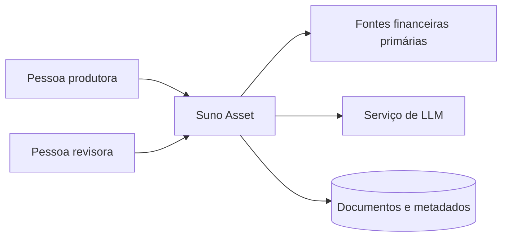
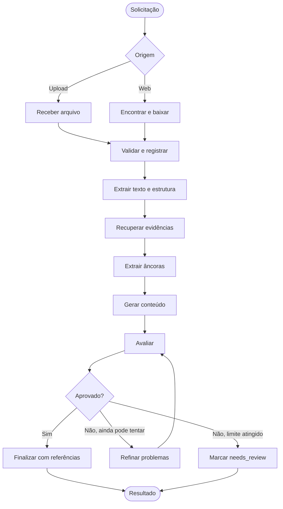
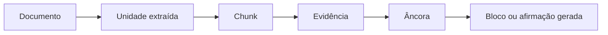

# Documentação do projeto — Suno Asset

> **Versão:** 0.1
>
> **Status:** base de produto aprovada para início do desenvolvimento
>
> **Última atualização:** 2026-09-25
> **Público deste documento:** equipe de produto, desenvolvimento, avaliação acadêmica e futuras pessoas mantenedoras

## 1. Resumo executivo

O Suno Asset é um sistema acadêmico de geração assistida de conteúdo financeiro. Ele recebe documentos públicos — como atas do Copom, fatos relevantes, releases de resultados e documentos de RI —, recupera os trechos relevantes, extrai fatos verificáveis e gera conteúdo adaptado ao conhecimento do leitor e ao formato desejado.

O diferencial do projeto não é apenas resumir um documento. O sistema deve:

- preservar informações materialmente relevantes;
- evitar afirmações não sustentadas pela fonte;
- adaptar linguagem e profundidade;
- avaliar automaticamente a saída;
- tentar corrigir problemas encontrados;
- mostrar de onde vieram as afirmações importantes.

O sistema apoia produção de conteúdo informativo. Ele não oferece recomendação personalizada de investimento.

## 2. Problema

Documentos financeiros públicos costumam ser longos, técnicos e difíceis de interpretar. LLMs generalistas facilitam a leitura, mas introduzem riscos:

- omissão de fatos importantes;
- invenção ou distorção de fatos e números;
- explicação incompatível com o conhecimento do leitor;
- uso inadequado de jargão;
- avaliação subjetiva quando um segundo LLM é o único juiz;
- ausência de rastreabilidade entre o texto produzido e a fonte.

O projeto busca reduzir esses riscos por meio de um pipeline controlado, com evidências, fatos estruturados, contratos de saída e avaliação em camadas.

## 3. Objetivos

### 3.1 Objetivo geral

Gerar conteúdo financeiro compreensível, fiel e rastreável a partir de documentos públicos.

### 3.2 Objetivos específicos

1. Aceitar documentos enviados pelo usuário e documentos recuperados de fontes web confiáveis.
2. Preservar a localização dos trechos extraídos.
3. Identificar fatos, números, decisões, justificativas, riscos e perspectivas relevantes.
4. Adaptar a produção a três níveis de conhecimento.
5. Suportar três formatos editoriais.
6. Avaliar estrutura, cobertura, sustentação e adequação.
7. Refinar automaticamente uma saída reprovada dentro de um limite.
8. Expor evidências e alertas de qualidade ao usuário.

## 4. Pessoas usuárias e públicos editoriais

### 4.1 Pessoa produtora de conteúdo

Seleciona uma fonte, define público e formato, solicita a geração e revisa o resultado e suas evidências.

### 4.2 Pessoa revisora

Inspeciona alertas, afirmações, citações e avaliações antes de publicar o conteúdo.

### 4.3 Público beginner

Não domina finanças. O conteúdo deve evitar jargão não explicado, apresentar conceitos essenciais e destacar impacto prático.

### 4.4 Público intermediate

Conhece termos comuns, como CDI, Selic, IPCA, dividendos e alocação. Explicações básicas repetitivas devem ser evitadas.

### 4.5 Público advanced

Aceita vocabulário especializado, como yield curve, forward guidance, output gap, EBITDA ajustado e covenants. Espera maior densidade analítica, relações entre indicadores, metodologia e limitações.

## 5. Escopo

### 5.1 Incluído no produto

- upload manual de documentos;
- descoberta e obtenção web controlada;
- validação e registro da origem;
- parsing com preservação de localização;
- segmentação e recuperação interna de trechos;
- extração de âncoras factuais;
- geração por público e formato;
- avaliação automática em camadas;
- refinamento limitado;
- citações e relatório de qualidade;
- histórico das revisões dentro da execução.

### 5.2 Escopo do primeiro vertical slice

- uma ata do Copom em PDF textual;
- upload manual;
- público beginner;
- texto analítico;
- parser por página;
- retrieval lexical;
- LLM simulado;
- avaliação estrutural e de cobertura;
- rastreabilidade até página e trecho.

### 5.3 Fora do MVP

- recomendação personalizada de investimento;
- execução de ordens;
- publicação automática em redes sociais;
- ingestão irrestrita da internet;
- treinamento ou fine-tuning de modelo próprio;
- OCR avançado como requisito inicial;
- colaboração multiusuário em tempo real;
- operação multi-tenant em larga escala;
- garantia absoluta de ausência de alucinações.

## 6. Jornada principal

1. A pessoa escolhe upload ou busca web.
2. Informa público, formato e foco editorial opcional.
3. O sistema valida e registra o documento.
4. O texto é extraído com referências à fonte.
5. Evidências relevantes são recuperadas.
6. Fatos estruturados — âncoras — são produzidos.
7. O conteúdo é gerado.
8. O conteúdo é avaliado.
9. Se aprovado, é finalizado com citações.
10. Se reprovado, é refinado e reavaliado.
11. Se o limite for atingido, é entregue como `needs_review`, acompanhado dos problemas.

## 7. Regras de negócio

| ID | Regra |
|---|---|
| RN-001 | Todo documento deve possuir identificador, origem e hash. |
| RN-002 | Documentos web devem manter URL original, URL canônica quando disponível e data de acesso. |
| RN-003 | Upload e web retrieval devem convergir para o mesmo contrato após a ingestão. |
| RN-004 | O parser extrai conteúdo e estrutura; ele não resume nem decide relevância. |
| RN-005 | Toda âncora deve apontar para pelo menos uma evidência do documento. |
| RN-006 | Afirmações financeiras materiais devem ser sustentadas por evidência. |
| RN-007 | Número, unidade, período e entidade não podem ser alterados sem suporte explícito. |
| RN-008 | Âncoras críticas devem estar presentes na saída ou justificadas no relatório. |
| RN-009 | O nível de linguagem deve respeitar o público selecionado. |
| RN-010 | A estrutura deve respeitar o formato selecionado. |
| RN-011 | Roteiros curtos devem ter duração estimada máxima de 60 segundos. |
| RN-012 | Uma falha crítica reprova o conteúdo independentemente da nota média. |
| RN-013 | O refinamento só pode corrigir problemas usando as evidências já disponíveis. |
| RN-014 | O ciclo de refinamento deve ser limitado e nunca aprovar silenciosamente ao esgotar tentativas. |
| RN-015 | Conteúdo não aprovado deve ser marcado como `needs_review` ou `failed`. |
| RN-016 | Fontes primárias devem ser priorizadas sobre republicações e comentários secundários. |
| RN-017 | Texto encontrado no documento deve ser tratado como dado, nunca como instrução para o sistema. |
| RN-018 | O resultado deve ser apresentado como conteúdo informativo, não como aconselhamento personalizado. |

## 8. Requisitos funcionais

Prioridades: **Must** é necessário no MVP, **Should** é esperado depois do vertical slice e **Could** é evolução.

| ID | Prioridade | Requisito | Critério de aceite resumido |
|---|---|---|---|
| RF-001 | Must | Receber PDF por upload. | Arquivo válido gera documento identificado; inválido retorna erro compreensível. |
| RF-002 | Should | Localizar documento na web. | Resultado registra origem, URL e data de acesso. |
| RF-003 | Must | Validar o artefato. | Tipo, tamanho, integridade e hash são verificados. |
| RF-004 | Must | Extrair texto por página. | Cada unidade extraída mantém número da página. |
| RF-005 | Should | Detectar necessidade de OCR. | PDF sem texto útil é sinalizado, sem produzir resultado enganoso. |
| RF-006 | Must | Segmentar o documento. | Chunks mantêm relação com unidades e offsets de origem. |
| RF-007 | Must | Recuperar evidências relevantes. | A execução produz candidatos com score e proveniência. |
| RF-008 | Must | Extrair âncoras. | Cada âncora contém tipo, importância e evidências. |
| RF-009 | Must | Gerar texto analítico. | Saída cumpre seu schema e possui referências. |
| RF-010 | Should | Gerar carrossel informativo. | Saída contém hook, cards ordenados e conclusão. |
| RF-011 | Should | Gerar roteiro curto. | Saída contém texto falado, sugestões visuais e duração estimada. |
| RF-012 | Must | Adaptar ao público. | Vocabulário e profundidade seguem o perfil selecionado. |
| RF-013 | Must | Executar validações determinísticas. | Violações estruturais aparecem no relatório. |
| RF-014 | Must | Avaliar cobertura e sustentação. | Âncoras ausentes e claims sem suporte são reportados. |
| RF-015 | Should | Avaliar adequação semanticamente. | Avaliador usa rubrica e resposta estruturada. |
| RF-016 | Must | Refinar conteúdo reprovado. | Problemas são enviados ao refinador e uma nova versão é avaliada. |
| RF-017 | Must | Limitar refinamentos. | Limite encerra o ciclo com status não aprovado. |
| RF-018 | Must | Finalizar conteúdo aprovado. | Saída final inclui conteúdo, referências e resumo da avaliação. |
| RF-019 | Must | Expor rastreabilidade. | É possível chegar da afirmação à página/trecho original. |
| RF-020 | Should | Preservar histórico da execução. | Versões e avaliações podem ser inspecionadas. |
| RF-021 | Could | Reprocessar com outro público/formato. | Documento já ingerido pode originar nova execução. |
| RF-022 | Could | Exportar conteúdo. | Formato exportável é definido sem perder referências. |

## 9. Requisitos não funcionais

| ID | Categoria | Requisito |
|---|---|---|
| RNF-001 | Fidelidade | Nenhuma saída pode ser marcada como aprovada se contiver hard failure conhecido. |
| RNF-002 | Rastreabilidade | Evidências devem manter `document_id`, `chunk_id` e localização disponível. |
| RNF-003 | Segurança | Uploads devem ter limites de MIME, tamanho, páginas e tempo de processamento. |
| RNF-004 | Segurança | Busca web deve bloquear esquemas inseguros, IPs privados e redirects excessivos. |
| RNF-005 | Privacidade | Documento integral, credenciais e segredos não devem aparecer em logs. |
| RNF-006 | Testabilidade | Nós do workflow devem permitir dependências simuladas e testes isolados. |
| RNF-007 | Manutenibilidade | Regras de público e formato devem ser configuração versionada. |
| RNF-008 | Portabilidade | Serviços externos devem ser acessados por interfaces/adapters. |
| RNF-009 | Observabilidade | Cada execução deve registrar request, nó, duração, resultado e iteração. |
| RNF-010 | Reprodutibilidade | Hash da fonte, configuração, prompts, modelo e parâmetros devem ser registráveis. |
| RNF-011 | Resiliência | Falhas esperadas devem produzir estado estruturado, sem corromper a execução. |
| RNF-012 | Custo | Loops e chamadas a modelos devem ter limites explícitos. |
| RNF-013 | Desempenho | Metas numéricas serão definidas após medir o vertical slice. |
| RNF-014 | Acessibilidade | A interface deve permitir leitura clara de conteúdo, status e citações. |

## 10. Formatos de saída

### 10.1 Texto analítico

- título;
- síntese;
- desenvolvimento;
- implicações;
- referências.

### 10.2 Carrossel informativo

- hook;
- sequência ordenada de cards;
- uma ideia principal por card;
- conclusão.

### 10.3 Roteiro de vídeo curto

- hook inicial;
- blocos de texto falado;
- sugestões de apoio visual;
- estimativa temporal;
- duração total estimada de até 60 segundos.

## 11. Arquitetura

### 11.1 Visão de contexto

### 11.2 Pipeline de processamento

O `State` do LangGraph é o contrato compartilhado entre os nós, não um nó independente. Ele guarda identificadores, configurações, resultados intermediários e controle da execução. Artefatos grandes são referenciados, não copiados integralmente para o estado.

### 11.3 Cadeia de proveniência

Contratos técnicos mais específicos serão materializados junto ao código e mantidos alinhados aos requisitos deste documento.

## 12. Stack tecnológica

### 12.1 Stack decidida

| Camada | Tecnologia | Papel |
|---|---|---|
| Linguagem | Python 3.12 | Implementação do backend e pipeline. |
| Dependências e ambiente | uv + `pyproject.toml` | Resolução, lockfile, ambientes e execução. |
| API | FastAPI | Contratos HTTP, validação e documentação OpenAPI. |
| Orquestração | LangGraph | Estado, nós, rotas condicionais e ciclo de refinamento. |
| Modelagem | Pydantic | Validação dos contratos de domínio e API. |
| Estado do grafo | `TypedDict` | Estado leve compatível com LangGraph. |
| Testes | pytest | Testes unitários, integração e contratos. |
| LLM inicial | Implementação fake/determinística | Testes reproduzíveis sem custo ou dependência externa. |
| Fixture inicial | Ata do Copom em PDF textual | Primeiro documento representativo do domínio. |

### 12.2 Escolhas provisórias

| Tema | Direção inicial | Motivo |
|---|---|---|
| Metadados | SQLite | Não exige serviço adicional no desenvolvimento. |
| Artefatos | filesystem atrás de interface | Simples localmente e substituível por object storage. |
| Retrieval | lexical antes do híbrido | Cria baseline antes de introduzir embeddings/vector DB. |
| Parsing | biblioteca Python local por página | Preserva rastreabilidade com pouca infraestrutura. |
| Refinamento | até duas tentativas | Limita custo e impede loops indefinidos. |

### 12.3 Ainda em aberto

- provedor e modelos reais de LLM e embeddings;
- biblioteca definitiva de PDF e estratégia de OCR;
- fontes/domínios de web retrieval;
- persistência e infraestrutura de produção;
- framework do frontend;
- pesos e thresholds do avaliador;
- taxa de fala usada na estimativa de vídeo;
- política de retenção.

## 13. Modelo conceitual de dados

| Entidade | Responsabilidade | Relações principais |
|---|---|---|
| `SourceRequest` | Descreve upload ou busca web. | Origina um documento. |
| `DocumentMetadata` | Identidade, origem, hash e datas. | Possui unidades extraídas. |
| `ParsedUnit` | Texto localizado por página/seção. | Origina chunks. |
| `Chunk` | Unidade recuperável do documento. | Origina evidências. |
| `Evidence` | Trecho selecionado e sua proveniência. | Sustenta âncoras. |
| `Anchor` | Fato estruturado e classificado. | Orienta geração e avaliação. |
| `GeneratedContent` | Saída segundo um formato. | Possui claims/blocos e referências. |
| `EvaluationReport` | Scores, falhas e correções. | Aprova ou direciona refinamento. |
| `Revision` | Versão intermediária. | Compõe o histórico da execução. |

## 14. Avaliação de qualidade

### 14.1 Camadas

1. **Estrutural:** schema, campos, tamanho, duração e referências.
2. **Cobertura:** presença das âncoras críticas.
3. **Sustentação:** claims, números, unidades e períodos contra evidências.
4. **Adequação:** linguagem, profundidade, clareza e formato.

### 14.2 Hard failures

- contradição de fato central;
- número, unidade ou período material incorreto;
- ausência de âncora crítica;
- afirmação financeira relevante sem evidência;
- saída incompatível com o schema;
- violação do limite de duração não corrigida.

### 14.3 Métricas a calibrar

- cobertura de âncoras críticas;
- taxa de claims sustentados;
- precisão de números e entidades;
- taxa de aprovação humana;
- ganho por refinamento;
- custo e latência por execução.

Os thresholds não serão inventados antes de existir um pequeno conjunto rotulado.

## 15. Interfaces externas conceituais

As rotas exatas serão consolidadas durante o vertical slice. O contrato conceitual esperado é:

| Operação | Responsabilidade |
|---|---|
| Criar documento por upload | Validar arquivo e retornar identidade. |
| Criar documento por busca web | Localizar, obter e registrar fonte. |
| Criar geração | Receber documento, público, formato e foco. |
| Consultar execução | Retornar status, iteração e eventuais falhas. |
| Consultar resultado | Retornar conteúdo, referências e avaliação. |
| Consultar evidência | Retornar trecho e localização na fonte. |

## 16. Estratégia de testes

### 16.1 Pirâmide

- **Unitários:** modelos, regras, parsers auxiliares, roteamento e avaliadores determinísticos.
- **Contratos:** entradas e saídas de cada nó.
- **Integração:** grafo completo com LLM fake e fixture local.
- **Qualidade:** corpus pequeno com âncoras e expectativas rotuladas.
- **End-to-end:** API até resultado final, sem depender inicialmente de serviços pagos.

### 16.2 Casos críticos

- PDF inválido, vazio ou sem texto;
- metadados ausentes;
- documento com instrução maliciosa;
- número contraditório ou unidade trocada;
- âncora crítica omitida;
- saída fora do formato;
- refinamento que continua falhando;
- limite de tentativas;
- evidência que aponta para página incorreta.

## 17. Segurança e privacidade

- validar MIME real, extensão, tamanho e integridade;
- gerar caminhos internos, nunca confiar no nome enviado;
- limitar páginas, tempo e memória;
- separar instruções do sistema do conteúdo recuperado;
- bloquear SSRF no web retrieval;
- manter segredos fora do código e dos logs;
- registrar somente o necessário para diagnóstico;
- definir política de retenção antes de armazenar documentos em produção;
- sinalizar que o conteúdo é informativo.

## 18. Observabilidade

Cada execução deve ser correlacionada por `request_id` e, quando aplicável, `document_id`. Eventos devem registrar:

- nó e transição do grafo;
- horário, duração, sucesso ou falha;
- quantidade de páginas, chunks, evidências e âncoras;
- versão de prompt e configuração;
- modelo, tokens, custo e latência quando disponíveis;
- scores, hard failures e iteração;
- sem incluir conteúdo integral ou segredo.

## 19. Roadmap

### Fase 0 — fundação

Estrutura Python, contratos Pydantic, estado, grafo, LLM fake e testes de roteamento.

### Fase 1 — vertical slice

Upload de ata do Copom, parsing por página, retrieval lexical, âncoras, texto beginner, avaliação e citações.

### Fase 2 — cobertura funcional

Três públicos, três formatos, avaliador semântico e refinamento completo.

### Fase 3 — aquisição web

Fontes primárias selecionadas, busca/obtenção segura e pipeline unificado.

### Fase 4 — qualidade e operação

Corpus rotulado, calibração, OCR, persistência, monitoramento e preparação de deploy.

## 20. Critérios de conclusão do MVP

O MVP estará funcional quando:

- processar uma ata do Copom textual via upload;
- produzir os três formatos para os três públicos;
- preservar citações verificáveis;
- detectar violações estruturais e omissões críticas conhecidas;
- executar refinamento limitado;
- nunca transformar uma reprovação final em aprovação silenciosa;
- possuir testes automatizados do fluxo principal e das falhas críticas;
- documentar decisões e limitações conhecidas.

## 21. Rastreabilidade entre requisitos e arquitetura

| Capacidade | Requisitos | Componentes |
|---|---|---|
| Entrada | RF-001–RF-003 | API, web retrieval, ingestão |
| Extração | RF-004–RF-006 | parser, chunker |
| Evidências | RF-007–RF-008, RF-019 | retrieval, âncoras, proveniência |
| Conteúdo | RF-009–RF-012 | gerador, perfis, schemas |
| Qualidade | RF-013–RF-017 | avaliadores, roteamento, refinador |
| Saída | RF-018, RF-020–RF-022 | finalizador, persistência, API |

## 22. Glossário

- **Âncora:** fato estruturado que deve orientar ou restringir a geração.
- **Chunk:** segmento recuperável do documento.
- **Claim:** afirmação verificável presente no conteúdo gerado.
- **Evidência:** trecho do documento com referência de origem.
- **Hard failure:** falha que impede aprovação, independentemente da média.
- **Ingestão:** validação e registro do documento e de sua origem.
- **Retrieval interno:** seleção de trechos dentro do documento processado.
- **Web retrieval:** descoberta e obtenção do documento na internet.
- **Rastreabilidade:** capacidade de navegar da afirmação até a fonte.
- **Vertical slice:** menor fluxo ponta a ponta capaz de demonstrar valor.

## 23. Governança da documentação

- Este documento é a fonte de verdade versionada sobre produto, requisitos e arquitetura.
- Contratos detalhados próximos da implementação devem ser documentados junto aos respectivos módulos.
- Mudanças de regra devem atualizar o requisito correspondente.
- Mudanças arquiteturais relevantes devem atualizar as seções de arquitetura, stack e dados deste documento.
- Notas pessoais ou instruções específicas de ferramentas não pertencem à documentação oficial e podem permanecer fora do versionamento.
