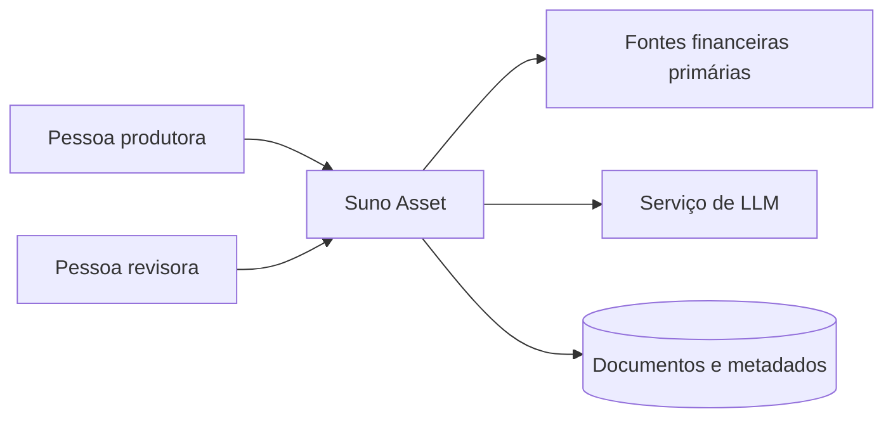
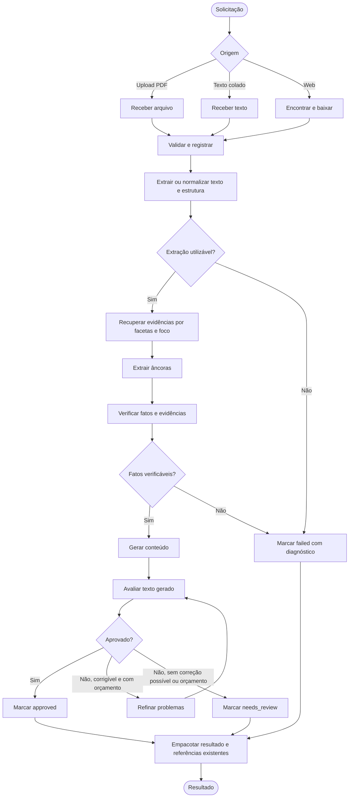

# Documentação do projeto — Suno Asset

## 1. Resumo executivo

O Suno Asset é um sistema acadêmico de geração assistida de conteúdo financeiro. Ele recebe documentos públicos — como atas do Copom, fatos relevantes, releases de resultados e documentos de RI —, recupera os trechos relevantes, extrai fatos verificáveis e gera conteúdo adaptado ao conhecimento do leitor e ao formato desejado.

O diferencial do projeto não é apenas resumir um documento. O sistema deve:

- preservar informações materialmente relevantes;
- evitar afirmações não sustentadas pela fonte;
- adaptar linguagem e profundidade;
- avaliar automaticamente a saída;
- tentar corrigir problemas encontrados;
- mostrar de onde vieram as afirmações importantes.

O sistema apoia produção de conteúdo informativo. Ele não oferece recomendação personalizada de investimento.

## 2. Problema

Documentos financeiros públicos costumam ser longos, técnicos e difíceis de interpretar. LLMs generalistas facilitam a leitura, mas introduzem riscos:

- omissão de fatos importantes;
- invenção ou distorção de fatos e números;
- explicação incompatível com o conhecimento do leitor;
- uso inadequado de jargão;
- avaliação subjetiva quando um segundo LLM é o único juiz;
- ausência de rastreabilidade entre o texto produzido e a fonte.

O projeto busca reduzir esses riscos por meio de um pipeline controlado, com evidências, fatos estruturados, contratos de saída e avaliação em camadas.

## 3. Objetivos

### 3.1 Objetivo geral

Gerar conteúdo financeiro compreensível, fiel e rastreável a partir de documentos públicos.

### 3.2 Objetivos específicos

1. Aceitar PDF enviado pelo usuário, texto colado e documentos recuperados de fontes web confiáveis.
2. Preservar a localização dos trechos extraídos.
3. Identificar fatos, números, decisões, justificativas, riscos e perspectivas relevantes.
4. Adaptar a produção a três níveis de conhecimento.
5. Suportar três formatos editoriais.
6. Avaliar estrutura, cobertura, sustentação e adequação.
7. Refinar automaticamente uma saída reprovada dentro de um limite.
8. Expor evidências e alertas de qualidade ao usuário.

## 4. Pessoas usuárias e públicos editoriais

### 4.1 Pessoa produtora de conteúdo

Seleciona uma fonte, define público e formato, solicita a geração e revisa o resultado e suas evidências.

### 4.2 Pessoa revisora

Inspeciona alertas, afirmações, citações e avaliações antes de publicar o conteúdo. A revisão humana e eventual edição são externas ao sistema. Aprovação automática não equivale a aprovação editorial; a avaliação só vale para a versão exata avaliada.

### 4.3 Público beginner

Não domina finanças. O conteúdo deve evitar jargão não explicado, apresentar conceitos essenciais e destacar impacto prático.

### 4.4 Público intermediate

Conhece termos comuns, como CDI, Selic, IPCA, dividendos e alocação. Explicações básicas repetitivas devem ser evitadas.

### 4.5 Público advanced

Aceita vocabulário especializado, como yield curve, forward guidance, output gap, EBITDA ajustado e covenants. Espera maior densidade analítica, relações entre indicadores, metodologia e limitações.

## 5. Escopo

### 5.1 Capacidades

- upload manual de PDF textual e entrada de texto colado;
- validação e registro da origem;
- extração com preservação de página e localização;
- segmentação e recuperação interna de trechos;
- extração e verificação de âncoras factuais;
- geração por público e formato;
- avaliação automática em camadas;
- refinamento limitado;
- citações e relatório de qualidade;
- histórico de análises, revisões e avaliações;
- interface local e API HTTP.

### 5.2 Limites do produto

- recomendação personalizada de investimento e execução de ordens;
- publicação automática em redes sociais;
- ingestão irrestrita da internet;
- treinamento ou fine-tuning de modelo próprio;
- execução de OCR;
- colaboração multiusuário em tempo real e operação multi-tenant;
- garantia absoluta de ausência de alucinações;
- editor de conteúdo e aprovação humana dentro da aplicação;
- geração de imagens de carrossel ou renderização de vídeo;
- suporte validado a documentos além de atas do Copom.

Essas capacidades estão fora do escopo. A detecção de extração insuficiente permanece obrigatória, mesmo sem OCR.

### 5.3 Entradas e operação

Cada execução usa um documento em português brasileiro. O suporte é a atas do Copom em PDF textual com extração verificável ou texto colado com proveniência declarada. Arquivos protegidos, extração parcial suspeita e estruturas incompatíveis devem produzir erro compreensível. Outros documentos exigem corpus e critérios próprios antes de serem anunciados como suportados.

Os três públicos e os três formatos usam contratos de saída próprios. Carrosséis e roteiros são entregues como texto estruturado. O modo simulado identifica explicitamente suas saídas e verifica controles determinísticos; não comprova qualidade semântica de inferência real.

A aplicação opera no computador da pessoa usuária, com interface e API restritas a localhost. A busca por tema da interface é uma demonstração com exemplo fixo; não recupera documentos da web. Descoberta e obtenção web controladas são uma extensão prevista, sujeita às regras de origem e segurança deste documento. Exposição remota e acesso multiusuário dependem das condições da seção 17.

## 6. Jornada principal

1. A pessoa envia um PDF ou cola o texto da fonte.
2. Informa público, formato e foco editorial opcional.
3. O sistema valida e registra o documento.
4. O texto é extraído com referências e diagnóstico de extração.
5. Evidências são recuperadas por facetas obrigatórias e foco editorial opcional.
6. Fatos estruturados — âncoras — são produzidos e vinculados às evidências.
7. O conteúdo é gerado com suas referências.
8. O conteúdo é avaliado segundo verificações obrigatórias para a etapa.
9. Se aprovado, é empacotado sem alteração de conteúdo.
10. Se houver problema corrigível com os insumos disponíveis e orçamento restante, o texto é refinado e reavaliado.
11. Esgotamento, problema não corrigível ou verificação obrigatória inconclusiva encerram sem aprovação: `needs_review` entrega uma versão inspecionável e seus problemas. Falha que impede essa entrega produz `failed`.

Capacidades ainda não implementadas são recusadas explicitamente, sem substituir silenciosamente público, formato ou origem.

## 7. Regras de negócio

| ID | Regra |
|---|---|
| RN-001 | Todo documento deve possuir identificador, origem e hash. |
| RN-002 | Documentos web devem manter URL original, URL canônica quando disponível e data de acesso. |
| RN-003 | Upload, texto colado e web retrieval devem convergir para o mesmo contrato após a ingestão, preservando localização adequada ao meio. |
| RN-004 | O parser extrai conteúdo e estrutura; ele não resume nem decide relevância. |
| RN-005 | Toda âncora deve apontar para pelo menos uma evidência do documento. |
| RN-006 | Afirmações financeiras materiais devem ser sustentadas por evidência. |
| RN-007 | Número, unidade, período e entidade não podem ser alterados sem suporte explícito. |
| RN-008 | Toda âncora crítica do recorte válido deve estar presente na saída aprovada. Justificar sua ausência não autoriza aprovação. O foco não pode excluir decisões centrais nem ressalvas necessárias à interpretação. |
| RN-009 | O nível de linguagem deve respeitar o público selecionado. |
| RN-010 | A estrutura deve respeitar o formato selecionado. |
| RN-011 | Roteiros curtos devem ter duração estimada máxima de 60 segundos. |
| RN-012 | Uma falha crítica reprova o conteúdo independentemente da nota média. |
| RN-013 | O refinamento usa somente insumos autorizados já disponíveis, conforme seção 14.5; não inventa fatos para corrigir falhas de parsing, retrieval ou extração. |
| RN-014 | O ciclo de refinamento deve ser limitado e nunca aprovar silenciosamente ao esgotar tentativas. |
| RN-015 | Conteúdo não aprovado deve ser marcado como `needs_review` ou `failed`. |
| RN-016 | Fontes primárias devem ser priorizadas sobre republicações e comentários secundários. |
| RN-017 | Texto encontrado no documento deve ser tratado como dado, nunca como instrução para o sistema. |
| RN-018 | O resultado deve ser apresentado como conteúdo informativo, não como aconselhamento personalizado. |
| RN-019 | Verificação obrigatória inconclusiva impede aprovação; ausência de erro detectado não equivale a sustentação verificada. |
| RN-020 | Evidência deve sustentar entidade, relação, período, condição, negação, atribuição e grau de certeza da afirmação, não apenas existir. |
| RN-021 | Avaliação se refere a uma versão imutável do conteúdo; alteração de texto ou referências exige nova avaliação. |
| RN-022 | Reprocessamento não pode redirecionar referências antigas para novos trechos; original e artefatos são identificados por versão. |
| RN-023 | Conteúdo histórico explicita seu período; data de acesso não comprova atualidade e hash não comprova autenticidade. |

## 8. Requisitos funcionais

Prioridades: **Must** identifica requisito essencial; **Should**, capacidade complementar prevista; **Could**, extensão opcional. A tabela descreve requisitos do produto; as combinações disponíveis em uma instalação são informadas por `GET /capabilities`.

| ID | Prioridade | Requisito | Critério de aceite resumido |
|---|---|---|---|
| RF-001 | Must | Receber PDF por upload. | Arquivo válido gera documento identificado; inválido retorna erro compreensível. |
| RF-002 | Should | Localizar documento na web. | Resultado registra origem, URL e data de acesso. |
| RF-003 | Must | Validar o artefato. | Tipo, tamanho, integridade e hash são verificados. |
| RF-004 | Must | Extrair texto com localização. | PDF mantém página física; texto colado mantém offsets, sem página fictícia. |
| RF-005 | Must | Detectar extração insuficiente. | Diagnóstico por página sinaliza ausência de texto, suspeita de extração parcial ou estrutura não suportada, sem aprovação silenciosa. |
| RF-006 | Must | Segmentar o documento. | Chunks mantêm relação com unidades e offsets de origem. |
| RF-007 | Must | Recuperar evidências relevantes. | A execução produz candidatos com score e proveniência. |
| RF-008 | Must | Extrair âncoras. | Cada âncora contém tipo, importância e evidências. |
| RF-009 | Must | Gerar texto analítico. | Saída cumpre seu schema e possui referências. |
| RF-010 | Must | Gerar carrossel informativo. | Saída contém hook, cards ordenados e conclusão. |
| RF-011 | Must | Gerar roteiro curto. | Saída contém texto falado, sugestões visuais e duração estimada. |
| RF-012 | Must | Adaptar ao público. | Vocabulário e profundidade seguem o perfil selecionado. |
| RF-013 | Must | Executar validações determinísticas. | Violações estruturais aparecem no relatório. |
| RF-014 | Must | Avaliar cobertura e sustentação. | Reportar âncoras ausentes, claims sem suporte e verificações inconclusivas; medir cobertura da recuperação separadamente em amostra rotulada. |
| RF-015 | Must | Avaliar adequação semanticamente. | Avaliador usa rubrica e resposta estruturada. |
| RF-016 | Must | Refinar problemas corrigíveis. | Redação/estrutura podem ser refinadas; insuficiência de evidência encerra sem inventar conteúdo. Cada nova versão é avaliada. |
| RF-017 | Must | Limitar refinamentos. | Limite encerra o ciclo com status não aprovado. |
| RF-018 | Must | Entregar resultado terminal. | Approved, needs_review e failed usam envelope comum com status, motivo e artefatos disponíveis, sem trocar a versão avaliada. |
| RF-019 | Must | Expor rastreabilidade. | É possível chegar da afirmação à página/trecho do PDF ou ao intervalo do texto colado original. |
| RF-020 | Must | Preservar histórico da execução. | Versões e avaliações podem ser inspecionadas. |
| RF-021 | Could | Reprocessar com outro público/formato. | Documento já ingerido pode originar nova execução. |
| RF-022 | Could | Exportar conteúdo. | Formato exportável é definido sem perder referências. |
| RF-023 | Should | Oferecer interface visual de revisão. | Consultar upload, resultado, alertas e evidências sem acessar diretamente a API. |
| RF-024 | Must | Declarar capacidades e modo. | Rejeitar combinações não suportadas; informar modo simulado/real e versão da política de avaliação. |
| RF-025 | Must | Receber texto colado como entrada alternativa. | Texto não vazio, dentro do limite, gera artefato versionado e unidades rastreáveis sem parser PDF; origem declarada não é tratada como autenticada. |

## 9. Requisitos não funcionais

| ID | Categoria | Requisito |
|---|---|---|
| RNF-001 | Fidelidade | Aprovação exige sucesso nas verificações obrigatórias aplicáveis da política versionada e ausência de hard failure conhecido. |
| RNF-002 | Rastreabilidade | Evidências devem manter `document_id`, `chunk_id` e localização disponível. |
| RNF-003 | Segurança | Uploads devem ter limites de MIME, tamanho, páginas e tempo de processamento. |
| RNF-004 | Segurança | Busca web deve bloquear esquemas inseguros, IPs privados e redirects excessivos. |
| RNF-005 | Privacidade | Documento integral, credenciais e segredos não devem aparecer em logs. |
| RNF-006 | Testabilidade | Nós do workflow devem permitir dependências simuladas e testes isolados. |
| RNF-007 | Manutenibilidade | Regras de público e formato devem ser configuração versionada. |
| RNF-008 | Portabilidade | Serviços externos devem ser acessados por interfaces/adapters. |
| RNF-009 | Observabilidade | Cada execução deve registrar request, nó, duração, resultado e iteração. |
| RNF-010 | Reprodutibilidade | Registrar hash, versões dos artefatos/parser, configuração, prompts, modelo e parâmetros para auditoria, sem prometer respostas idênticas de serviço externo. |
| RNF-011 | Resiliência | Falhas esperadas devem produzir estado estruturado, sem corromper a execução. |
| RNF-012 | Custo | Limitar ciclos, tokens, chamadas incluindo retries/refinamentos e duração total; não truncar insumos críticos silenciosamente. |
| RNF-013 | Desempenho | Metas de desempenho devem ser definidas a partir de medições representativas e publicadas com seu escopo. |
| RNF-014 | Acessibilidade | A interface deve permitir leitura clara de conteúdo, status e citações. |
| RNF-015 | Acesso | Antes da exposição remota, definir autenticação, autorização dos artefatos e cotas; identificadores não são credenciais. |
| RNF-016 | Privacidade externa | Para uso do LLM real, definir dados enviados, retenção aplicável no provedor e condições de uso de documentos públicos autorizados. |

## 10. Formatos de saída

### 10.1 Texto analítico

- título;
- síntese;
- desenvolvimento;
- implicações;
- referências.

### 10.2 Carrossel informativo

- hook;
- sequência ordenada de cards: no perfil econômico híbrido, quatro cards de conteúdo, além de hook e conclusão; nos demais perfis, de 5 a 10 cards;
- uma ideia principal por card;
- conclusão.

### 10.3 Roteiro de vídeo curto

- hook inicial;
- blocos de texto falado;
- sugestões de apoio visual;
- estimativa temporal;
- duração total estimada de até 60 segundos a 130 palavras por minuto, somando pausas declaradas. Não omitir fatos materiais para caber.

## 11. Arquitetura

### 11.1 Visão de contexto

### 11.2 Pipeline de processamento

O `State` do LangGraph é o contrato compartilhado entre os nós, não um nó independente. Ele guarda identificadores, configurações, resultados intermediários e controle da execução. Artefatos grandes são referenciados, não copiados integralmente para o estado. O grafo mostra o caminho de negócio; erros esperados em qualquer nó são classificados pela seção 14.4. Falhas no próprio empacotamento produzem erro estruturado na fronteira da aplicação.

Há dois pontos de controle sequenciais. Antes da geração, verificar as âncoras contra os trechos originais e os diagnósticos de extração/recuperação: números, unidades, períodos, condições, negações, atribuições, relações de causa e cobertura das facetas obrigatórias. Fato material sem suporte ou evidência obrigatória inconclusiva impede gerar conteúdo e produz diagnóstico. Essa checagem não prova que todos os fatos relevantes foram encontrados; perdas são medidas separadamente contra a amostra anotada por pessoa.

Depois de cada geração ou refinamento, avaliar o texto: schema, cobertura dos fatos verificados, fidelidade de cada afirmação às evidências originais, referências e adequação ao público/formato. Fatos verificados são a base esperada, mas não bastam como única fonte de conferência: o gerador pode criar afirmações novas ou distorcer um fato, exigindo retorno à evidência. Resultados dos dois pontos de controle e suas versões ficam separados no histórico. Acesso às evidências pode ocorrer por referências via storage, sem copiar o documento para o estado.

`TypedDict` descreve o estado para tipagem, mas não substitui validação em execução. Entradas externas, saídas de serviços e pré-condições dos nós são validadas. Os contratos são discriminados por formato e a arquitetura literal oferece os três públicos × três formatos. A arquitetura de compatibilidade preserva texto analítico para iniciantes.

### 11.3 Cadeia de proveniência

Contratos técnicos mais específicos são materializados no código, com `WorkflowState` como `TypedDict`, serviços injetáveis, armazenamento local e controles anteriores e posteriores à geração. A função Python `run_workflow(request, *, services, policy)` retorna `ExecutionResult`; a interface HTTP é descrita em [API](api.md). Cada afirmação material aponta para evidências que sustentem todas as suas partes; uma referência genérica no bloco não valida afirmações adicionais.

Página física do PDF, numeração impressa quando disponível e offsets no texto extraído versionado são conceitos distintos. Para texto colado, não inventar página física: usar offsets no texto original/normalizado versionado e, se útil, índices de parágrafo ou linha. Normalização e novo chunking não sobrescrevem a base de citações anterior. Identidade do artefato por hash é distinta de identidade da origem e da execução: bytes iguais podem ter várias origens registradas. Texto colado é fonte declarada pela pessoa usuária; URL ou título informados por ela são metadados declarados, não comprovação de autenticidade. A entrada seleciona exatamente um meio por solicitação, mas PDF e texto convergem para os mesmos contratos de unidades, evidências e avaliação. O parser não deve presumir cabeçalhos, itens ou tabelas idênticos entre edições.

## 12. Stack tecnológica

| Camada | Tecnologia | Papel |
|---|---|---|
| Linguagem | Python 3.12 | Backend e pipeline. |
| Dependências e ambiente | uv + `pyproject.toml` + `uv.lock` | Instalação e execução reproduzíveis. |
| API | FastAPI | Contratos HTTP, validação e documentação OpenAPI. |
| Orquestração | LangGraph | Estado, nós, rotas condicionais e refinamento. |
| Modelagem | Pydantic | Validação de domínio e API. |
| Estado do grafo | `TypedDict` | Estado leve compartilhado entre nós. |
| Parsing | `pdfplumber` e leitura UTF-8 | PDF textual por página e texto colado com offsets. |
| Recuperação | Índice lexical e preparação da fonte | Seleção de evidências e preservação de contexto. |
| Inferência | Adaptadores Gemini e Groq | Extração, verificação, geração e avaliação estruturadas. |
| Metadados | SQLite | Execuções, idempotência, eventos e controle de cotas. |
| Artefatos | Sistema de arquivos atrás de interface | Documentos, evidências, revisões e avaliações. |
| Interface | HTML, CSS e JavaScript | Estúdio local servido pela API, sem build separado. |
| Testes | pytest e Playwright | Contratos, integração e navegação. |

O modo simulado usa serviços determinísticos sem credenciais. Provedor, modelos e limites são configurados conforme o [guia de configuração](configuration.md). A arquitetura econômica combina regras locais com extração e verificação compartilhadas; seus controles estão em [arquitetura híbrida](hybrid-architecture.md).

## 13. Modelo conceitual de dados

| Entidade | Responsabilidade | Relações principais |
|---|---|---|
| `SourceRequest` | Descreve upload ou busca web. | Origina um documento. |
| `DocumentMetadata` | Identidade, origem, hash e datas. | Possui unidades extraídas. |
| `ParsedUnit` | Texto localizado por página/seção. | Origina chunks. |
| `Chunk` | Unidade recuperável do documento. | Origina evidências. |
| `Evidence` | Trecho selecionado e sua proveniência. | Sustenta âncoras. |
| `Anchor` | Fato estruturado e classificado. | Orienta geração e avaliação. |
| `GeneratedContent` | Saída segundo um formato. | Possui claims/blocos e referências. |
| `EvaluationReport` | Resultados por verificação, issues, política e versão avaliada. | Determina aprovação, refinamento ou revisão. |
| `Revision` | Versão imutável com sua avaliação. | Compõe o histórico da execução. |
| `ExecutionResult` | Status, modo simulado/real, motivo e artefatos disponíveis. | Referencia versão entregue, avaliação e evidências. |

Valores ausentes devem ser distinguidos de valores inferidos. Metadados temporais incluem publicação e período/evento quando disponíveis, separados da data de acesso e da origem declarada/verificada. Informação ausente não deve ser inventada.

Fatos numéricos preservam representação original e valor normalizado, unidade, escala, entidade, período, comparação e qualificadores relevantes. Porcentagem não é ponto percentual. Normalizações equivalentes são testadas; arredondamentos exigem regra explícita. Cálculos permitidos registram operação, insumos e evidências, sem exigir uma linguagem genérica de cálculos no escopo do produto.

## 14. Avaliação de qualidade

### 14.1 Camadas

1. **Estrutural:** schema, campos, tamanho, duração e referências.
2. **Cobertura:** presença das âncoras críticas na saída e, separadamente, recuperação dos fatos esperados na amostra rotulada.
3. **Sustentação:** claims e âncoras contra evidências originais, incluindo números, entidades, unidades, períodos e qualificadores.
4. **Adequação:** linguagem, profundidade, clareza e formato.

As camadas são critérios, não uma única chamada de avaliação. O primeiro ponto de controle ocorre antes da geração e julga os fatos extraídos contra a fonte; essas âncoras internas não recebem nota de linguagem para o público. O segundo ocorre após cada versão do texto e julga a saída contra os fatos verificados e a fonte, incluindo clareza para o público selecionado. No modo real, ambos precisam passar nas verificações obrigatórias aplicáveis para aprovação.

### 14.2 Hard failures

- contradição de fato central;
- número, unidade ou período material incorreto;
- ausência de âncora crítica;
- afirmação financeira relevante sem evidência;
- saída incompatível com o schema;
- violação do limite de duração não corrigida.

### 14.3 Métricas a calibrar

- cobertura de âncoras críticas;
- taxa de claims sustentados;
- precisão de números e entidades;
- taxa de aprovação humana;
- ganho por refinamento;
- custo e latência por execução.

Os limiares semânticos devem ser calibrados em amostra rotulada, com fonte, período, público, formato, fatos críticos, ressalvas e justificativas. Fidelidade factual, cobertura, números, citações e formato são dimensões separadas da adequação ao público. Casos de ajuste e casos reservados para avaliação devem permanecer separados; seus rótulos não são insumos do gerador. Regras estruturais e falhas críticas independem de nota média. Julgamentos do próprio pipeline não substituem revisão independente. O método e os limites dos dados de teste estão em [avaliação](evaluation.md).

### 14.4 Aprovação, revisão e falha

A API expõe `GET /capabilities`, resolve arquitetura e perfil antes da idempotência e registra a configuração efetiva nos manifestos. Cada pedido gera somente o formato solicitado.

Cada verificação retorna `passed`, `failed` ou `not_verified`, com motivo e escopo. A política versionada determina quais verificações são obrigatórias; não pode ser relaxada durante a execução para obter aprovação. Verificações não aplicáveis ao formato são identificadas como tais, sem serem contadas como sucesso. A aplicabilidade é determinada pela política, não por decisão livre do gerador ou avaliador.

- `approved`: todas as verificações obrigatórias aplicáveis passaram e não existe hard failure conhecido.
- `needs_review`: há conteúdo inspecionável, mas uma verificação obrigatória falhou/não pôde ser concluída, o formato é inviável para os fatos obrigatórios ou o orçamento terminou.
- `failed`: não é possível produzir/entregar conteúdo inspecionável, por exemplo arquivo inválido, parsing inutilizável ou resposta fora do schema sem versão anterior válida.

No modo simulado, `approved` valida somente o cenário técnico e a fixture. No modo real, a política exige avaliação estrutural, cobertura, sustentação e adequação. Mesmo aprovado, o resultado mantém limitações e escopo; não garante ausência absoluta de alucinação.

O envelope terminal inclui request/document IDs quando existentes, modo, status, motivo, versão entregue ou ausência explícita, avaliação correspondente, issues, referências disponíveis e histórico. Conteúdo fora do schema não é apresentado como `GeneratedContent` válido. Falha técnica após uma versão válida pode entregar essa versão como `needs_review`, com a falha posterior registrada.

### 14.5 Cobertura, foco e insumos autorizados

Fatos críticos anotados diretamente na fonte permitem medir perdas de extração e recuperação separadamente da cobertura na geração. Rótulos de avaliação não alimentam o gerador real nem recuperam artificialmente evidências ausentes. Serviços simulados podem usar saídas fixas para testar orquestração, sem serem prova de qualidade.

Na execução, facetas mínimas de decisão, números, justificativas, riscos e perspectivas são verificadas independentemente do foco opcional. Ausência de evidência é registrada sem invenção, distinguindo assunto não presente na fonte de busca inconclusiva quando houver base para isso. Uma consulta sem resultado não prova que o fato inexiste nem autoriza classificá-lo automaticamente como não aplicável. Candidatos por faceta não provam cobertura integral: o desempenho é medido contra rótulos independentes. Classificação de âncoras críticas, incluindo ressalvas que alteram o sentido, segue rubrica versionada.

O foco seleciona assuntos secundários, mas não elimina fatos centrais nem suas condições. Se fatos obrigatórios e explicações necessárias não couberem no formato, informar incompatibilidade e entregar `needs_review` quando houver rascunho válido. Outro foco ou formato exige nova solicitação, sem mudança silenciosa.

Insumos autorizados são evidências da fonte e um glossário educacional pequeno, revisado e versionado, com origem registrada. Explicações do glossário são identificadas como contexto educacional. Inferências são apresentadas como interpretações limitadas aos fatos citados; não introduzem causalidade, previsão ou recomendação sem suporte. Cálculos simples exigem operação determinística verificada; demais análises ficam fora do escopo. Nenhuma fonte externa é buscada silenciosamente para completar explicações.

### 14.6 Refinamento e seleção de versão

Cada issue indica origem e se é corrigível com os insumos disponíveis. Redação, estrutura e referência corrigível podem seguir para refinamento. Falta de evidência, parsing insuficiente e conflito factual não resolvível encerram sem repetir redação. Novo parsing/retrieval, quando solicitado, pertence a outra execução no escopo do produto.

Geração inicial é revisão 0. Duas tentativas significam no máximo duas novas revisões editoriais; retries técnicos são contabilizados separadamente e consomem o orçamento global. A primeira revisão aprovada encerra o ciclo. Sem aprovação, entrega-se a última revisão válida sem regressão frente à anteriormente selecionada: novos hard failures ou perda de verificações obrigatórias antes aprovadas impedem substituí-la. Comparação inconclusiva preserva a anterior e registra o motivo. Todas as tentativas ficam no histórico; nota média isolada não escolhe a versão.

`finalize` somente empacota texto e referências já avaliados. Alterar afirmações ou associações de evidência exige nova avaliação.

### 14.7 Extração parcial e orçamento de contexto

A extração é validada por página, com casos de texto ausente, PDF protegido e extração parcial. Páginas legitimamente vazias são diferenciadas de falhas por heurística conservadora; heurísticas não garantem detectar toda perda. Estruturas não suportadas ou perda suspeita de conteúdo material bloqueiam a geração inicial com diagnóstico. OCR não é necessário para rejeitar essas entradas.

O orçamento define tokens por etapa, saída reservada, número total de chamadas e prazo global antes de chamar o modelo. Estouro de contexto e resposta truncada geram problema estruturado. Reduzir conteúdo só é permitido preservando fatos obrigatórios e proveniência; caso contrário, encerrar sem aprovação. Limites efetivos constam da configuração e dos manifestos da execução.

## 15. Interfaces externas

A API local possui as seguintes operações. Schemas e respostas detalhadas ficam em `/docs` e no [guia da API](api.md).

| Operação | Responsabilidade |
|---|---|
| `GET /health` | Verificar disponibilidade da aplicação. |
| `GET /capabilities` | Informar combinações, padrões e configuração efetiva. |
| `POST /documents` | Validar PDF ou texto colado e retornar identidade. |
| `POST /generations` | Gerar conteúdo a partir de documento, público, formato e foco. |
| `GET /generations` | Listar análises recentes. |
| `GET /generations/{request_id}` | Retornar resultado, referências e avaliação. |
| `GET /generations/{request_id}/status` | Consultar o estado operacional da execução. |
| `GET /generations/{request_id}/evidence/{index}` | Retornar trecho e localização da evidência vinculada ao resultado. |

A execução HTTP é síncrona. A idempotência é persistida em SQLite, com tratamento de pedidos idênticos em andamento e conflito de payload. Isso reduz duplicações dentro do escopo local, sem prometer execução exatamente uma vez no provedor. Desconexão do cliente não confirma cancelamento.

Consulta de evidência verifica existência e vínculo com execução/documento. Evidência excluída ou indisponível retorna estado explícito, nunca redirecionamento para outro artefato. Busca web não possui operação funcional de ingestão nesta API.

## 16. Estratégia de testes

### 16.1 Pirâmide

- **Unitários:** modelos, regras, parsers auxiliares, roteamento e avaliadores determinísticos.
- **Contratos:** entradas e saídas de cada nó.
- **Integração:** grafo completo com LLM fake e fixture local.
- **Qualidade:** corpus pequeno com âncoras e expectativas rotuladas.
- **End-to-end:** API até resultado final, sem depender inicialmente de serviços pagos.

### 16.2 Casos críticos

- PDF inválido, vazio ou sem texto;
- metadados ausentes;
- documento com instrução maliciosa;
- número contraditório ou unidade trocada;
- âncora crítica omitida;
- saída fora do formato;
- refinamento que continua falhando;
- limite de tentativas;
- evidência que aponta para página incorreta;
- fato esperado não selecionado pelo retrieval;
- âncora com referência válida e interpretação incorreta;
- negação, condição ou atribuição perdida;
- extração parcial, página sem texto e PDF protegido;
- formato inviável para conteúdo obrigatório;
- avaliador inconclusivo ou indisponível;
- refinamento com regressão e finalização que tenta alterar conteúdo;
- estouro de contexto, resposta truncada e reenvio;
- capacidade ainda não implementada solicitada pela API.

### 16.3 Amostra e avaliação independente

Anotações da fonte, exemplos negativos e rubricas permitem avaliar recuperação e conteúdo separadamente. Exemplos usados para ajustar prompts devem permanecer separados dos reservados para avaliação. Reportar o tamanho da amostra e não alegar generalização para todos os documentos financeiros.

Prompts e políticas são ajustados em um conjunto próprio de calibração. O conjunto reservado é usado para avaliação; se orientar ajustes, perde independência e deve ser renovado ou essa limitação registrada. Divergências entre revisores são adjudicadas e registradas; com apenas um revisor, registrar a limitação. A avaliação deve consolidar medidas por público e formato, mantendo fixa a política usada na medição.

### 16.4 Fundação reproduzível

A instalação com lockfile, a importação, o health check e os testes devem funcionar em ambiente limpo sem credencial de provedor. A integração contínua reproduz instalação e testes sem segredos. Dependências e lockfile devem permanecer consistentes.

## 17. Segurança e privacidade

- validar MIME real, extensão, tamanho e integridade;
- gerar caminhos internos, nunca confiar no nome enviado;
- limitar páginas, tempo e memória;
- separar instruções do sistema do conteúdo recuperado;
- bloquear SSRF no web retrieval;
- manter segredos fora do código e dos logs;
- registrar somente o necessário para diagnóstico;
- definir política de retenção antes de armazenar documentos em produção;
- sinalizar que o conteúdo é informativo.

O modo simulado usa serviços locais. No modo real, os adaptadores Gemini e Groq recebem texto e contexto necessários à extração, verificação, geração e avaliação; o PDF bruto permanece no armazenamento local. Credenciais são lidas do ambiente ou do `.env` local, sem inclusão no repositório. Usar apenas documentos públicos autorizados e conferir as condições de retenção e privacidade da conta do provedor. A retenção local é independente da retenção externa. O [guia de configuração](configuration.md) descreve os controles de cada integração.

Antes de exposição remota, definir e testar autenticação, autorização para documentos/execuções/evidências, limites de consumo e entrega segura de arquivos/texto. Documento e saída do modelo não podem ser executados como HTML/script pelo frontend. Uso local controlado não exige antecipar multi-tenancy.

Na operação local, os artefatos persistidos não têm expiração automática. A exclusão manual deve abranger originais, texto extraído, índices, revisões e checkpoints vinculados, conforme o recurso selecionado. Os comandos estão em [operação local](operations.md). Essa retenção não define política para eventual serviço remoto. A exclusão pode impedir a verificação futura das referências; falhas parciais de gravação não devem produzir referências aparentemente disponíveis para arquivos inexistentes.

## 18. Observabilidade

Cada execução deve ser correlacionada por `request_id` e, quando aplicável, `document_id`. Eventos devem registrar:

- nó e transição do grafo;
- horário, duração, sucesso ou falha;
- quantidade de páginas, chunks, evidências e âncoras;
- versão de prompt e configuração;
- modelo, tokens, custo e latência quando disponíveis;
- scores, hard failures e iteração;
- sem incluir conteúdo integral ou segredo.

## 19. Documentação complementar

A documentação complementar descreve o uso e os limites das capacidades do produto:

- [Configuração](configuration.md): ambiente, provedores e cotas.
- [Ingestão](ingestion.md): entradas, limites e diagnóstico de extração.
- [API](api.md): operações, exemplos e idempotência.
- [Estúdio de conteúdo](frontend.md): interface, referências e histórico.
- [Arquitetura híbrida](hybrid-architecture.md): preparação, seleção e avaliação.
- [Operação local](operations.md): armazenamento, recuperação e exclusão.
- [Avaliação](evaluation.md): método, dados de teste e limitações.

## 20. Critérios de qualidade

Os critérios de qualidade do produto são:

- processar atas do Copom textuais via upload, dentro dos limites e estruturas declarados;
- produzir conteúdo com LLM real nos três formatos para os três públicos, em português brasileiro;
- oferecer API documentada com consulta de resultados e evidências;
- preservar citações verificáveis vinculadas à versão avaliada;
- detectar violações estruturais e omissões críticas conhecidas e impedir aprovação com verificações obrigatórias inconclusivas;
- executar refinamento limitado, tratando falhas não corrigíveis e regressões;
- entregar status e artefatos consistentes em approved, needs_review e failed;
- possuir testes automatizados do fluxo principal e das falhas críticas;
- medir recuperação, fidelidade, adequação, custo e latência em amostra com revisão independente e limitações declaradas;
- cumprir metas de qualidade definidas a partir da amostra de calibração antes da avaliação independente, registrando metas e resultados sem ajuste retroativo para aprovar a entrega;
- manter artefatos e avaliações durante a retenção declarada e permitir demonstração reproduzível local;
- documentar decisões, capacidades suportadas e limitações.

Busca web, exportação, OCR e hospedagem pública exigem requisitos e avaliação próprios. A interface local não elimina a necessidade de verificar os resultados e suas evidências.

## 21. Rastreabilidade entre requisitos e arquitetura

| Capacidade | Requisitos | Componentes |
|---|---|---|
| Entrada | RF-001–RF-003, RF-025 | API, web retrieval, ingestão |
| Extração | RF-004–RF-006 | parser, chunker |
| Evidências | RF-007–RF-008, RF-019 | retrieval, âncoras, proveniência |
| Conteúdo | RF-009–RF-012 | gerador, perfis, schemas |
| Qualidade | RF-013–RF-017 | avaliadores, roteamento, refinador |
| Saída | RF-018, RF-020–RF-022 | finalizador, persistência, API |
| Interface e capacidades | RF-023–RF-024 | frontend, API, configuração |
| Aprovação e versões | RN-019–RN-023, RNF-001, RNF-010 | avaliadores, revisões, metadados |
| Acesso e dados externos | RNF-015–RNF-016 | API, adapter de LLM |

## 22. Glossário

- **Âncora:** fato estruturado que deve orientar ou restringir a geração.
- **Chunk:** segmento recuperável do documento.
- **Claim:** afirmação verificável presente no conteúdo gerado.
- **Evidência:** trecho do documento com referência de origem.
- **Hard failure:** falha que impede aprovação, independentemente da média.
- **Ingestão:** validação e registro do documento e de sua origem.
- **Retrieval interno:** seleção de trechos dentro do documento processado.
- **Web retrieval:** descoberta e obtenção do documento na internet.
- **Rastreabilidade:** capacidade de navegar da afirmação até a fonte.

## 23. Governança da documentação

Este documento reúne a definição do produto, seus requisitos e suas regras de qualidade. Os guias complementares detalham instalação, contratos, configuração e operação.

Mudanças de regra devem atualizar o requisito correspondente. Alterações arquiteturais devem manter coerentes as descrições de processamento, dados e integrações. Exemplos públicos devem usar dados sintéticos ou fontes públicas identificadas, sem credenciais, dados de conta ou resultados locais de execução.
